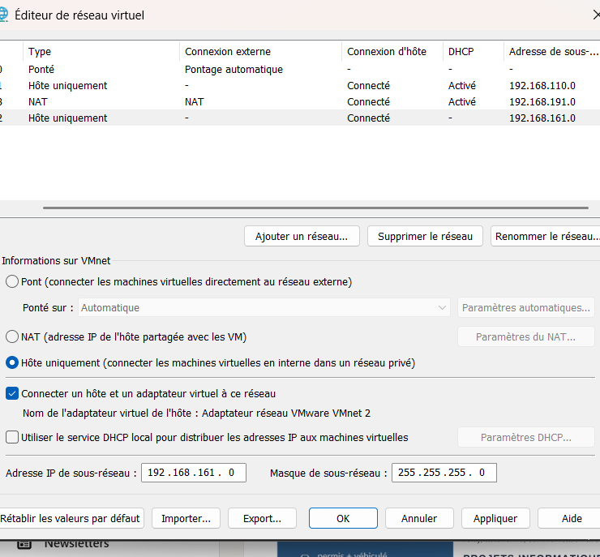
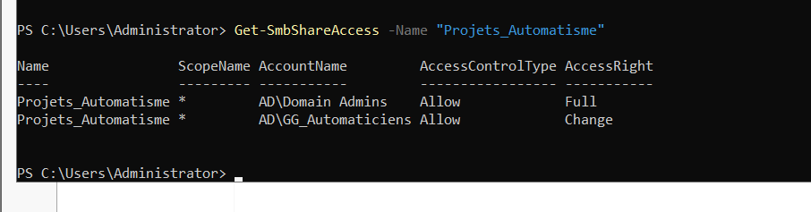
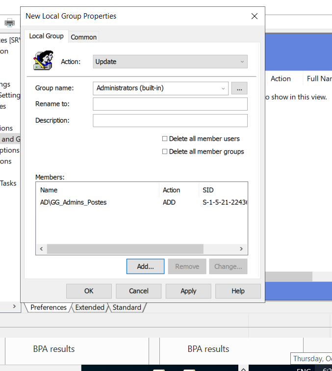

# Windows Server & Active Directory — Laboratoire OT/IT

**Conception, déploiement et administration d'une infrastructure Windows Server virtualisée pour un environnement d'automatisme industriel.**

Ce projet consiste à mettre en place un laboratoire personnel **OT/IT (Operational Technology / Information Technology)** utilisant VMware Workstation, Windows Server 2022, Active Directory, DNS, SMB et les stratégies de groupe (GPO).

L'objectif est de reproduire les mécanismes d'administration centralisée rencontrés dans les environnements industriels : gestion des utilisateurs, contrôle des accès, communication entre postes d'ingénierie et serveurs, partage de ressources et politiques de sécurité.

## 1. Objectifs du projet

- Installer et configurer un serveur Windows virtualisé.
- Construire un réseau virtuel privé avec VMware.
- Déployer un contrôleur de domaine Active Directory.
- Centraliser l'authentification des utilisateurs et des machines.
- Configurer les groupes de sécurité et les autorisations NTFS/SMB.
- Automatiser l'attribution des droits administrateur locaux via GPO.
- Intégrer une VM Siemens TIA Portal dans le domaine.
- Diagnostiquer et résoudre les problèmes réseau et d'authentification.

## 2. Environnement technique

| Composant | Technologie |
|---|---|
| Machine hôte | Lenovo LOQ — Windows 11 |
| Hyperviseur | VMware Workstation |
| Serveur | Windows Server 2022 Standard Evaluation |
| Poste industriel | Windows 10 Pro — VM TIA Portal |
| Domaine Active Directory | `ad.lab` |
| Contrôleur de domaine | `SRV-LAB` |
| Services réseau | DNS, LDAP, Kerberos, SMB |
| Administration | PowerShell, RSAT, GPMC, ADUC |
| Sécurité | Groupes AD, NTFS, GPO, pare-feu Windows |

## 3. Architecture réseau

Le laboratoire utilise le réseau virtuel VMware **VMnet2**, configuré en Host-only avec DHCP désactivé.

| Équipement | Adresse IPv4 | Fonction |
|---|---|---|
| Windows 11 hôte | `192.168.161.1` | Administration et accès au laboratoire |
| SRV-LAB | `192.168.161.10` | Contrôleur de domaine et DNS |
| VM TIA Portal | `192.168.161.20` | Poste d'ingénierie Siemens |
| Réseau VMnet2 | `192.168.161.0/24` | Communication entre les machines |

La VM TIA Portal dispose de deux interfaces :

- **NAT** : accès à Internet.
- **VMnet2** : communication avec le laboratoire Active Directory.

## 4. Déploiement d'Active Directory

Le serveur `SRV-LAB` a été promu en contrôleur de domaine pour la forêt `ad.lab`.

Les principaux services configurés sont :

- **Active Directory Domain Services (AD DS)** : gestion centralisée des identités.
- **DNS Server** : résolution des noms et localisation du contrôleur de domaine.
- **Kerberos** : authentification des utilisateurs du domaine.
- **LDAP** : accès aux informations de l'annuaire.
- **SYSVOL / NETLOGON** : distribution des stratégies et ressources du domaine.

La configuration DNS et la découverte du contrôleur ont été validées avec les outils PowerShell et Windows.

## 5. Organisation des utilisateurs et des groupes

Des unités d'organisation (OU) ont été créées :

- `LAB_Utilisateurs`
- `LAB_Administrateurs`
- `LAB_Groupes`
- `LAB_Postes_Industriels`

Deux groupes de sécurité ont été configurés :

| Groupe | Fonction |
|---|---|
| `GG_Automaticiens` | Accès aux ressources des projets d'automatisme |
| `GG_Admins_Postes` | Administration locale des postes industriels ciblés |

Deux comptes de laboratoire permettent de distinguer les privilèges :

- `AD\sekou` : utilisateur standard.
- `AD\admin.sekou` : compte dédié à l'administration.

Cette organisation applique le principe du **moindre privilège**, en séparant les tâches quotidiennes des opérations d'administration.

## 6. Configuration des partages SMB et NTFS

Un dossier de projets industriels a été créé sur `SRV-LAB` :

`C:\LAB\Projets_Automatisme`

Il est accessible depuis le réseau :

`\\SRV-LAB\Projets_Automatisme`

Les autorisations configurées sont :

| Groupe | Permissions SMB |
|---|---|
| `Domain Admins` | Full Control |
| `GG_Automaticiens` | Change / Read |

Le groupe `GG_Automaticiens` dispose également du droit **Modify** sur le dossier via les autorisations NTFS.

Les accès ont été testés depuis Windows 11 et la VM TIA Portal avec un compte de domaine.

## 7. Administration centralisée par GPO

Une stratégie de groupe a été créée :

**`GPO_Admins_Locaux_Postes`**

Elle est liée à l'OU `LAB_Postes_Industriels`.

Cette stratégie utilise :

`Computer Configuration > Preferences > Control Panel Settings > Local Users and Groups`

La règle ajoute automatiquement `AD\GG_Admins_Postes` au groupe local **Administrators**, en utilisant l'action *Update*, sans supprimer les administrateurs existants.

### Validation

Après application de la stratégie, la présence du groupe `AD\GG_Admins_Postes` dans les administrateurs locaux de la VM TIA Portal a été vérifiée avec PowerShell.

Une élévation de privilèges utilisant `AD\admin.sekou` a également été testée avec succès.

## 8. Intégration de la VM Siemens TIA Portal

La VM Windows 10, identifiée par le nom `DESKTOP-H6FRU6M`, a été intégrée au domaine `ad.lab`.

Les opérations comprennent :

- Configuration d'une deuxième carte réseau VMware.
- Attribution d'une adresse IP fixe sur VMnet2.
- Configuration du DNS vers `192.168.161.10`.
- Vérification de la découverte du contrôleur de domaine.
- Jonction au domaine Active Directory.
- Connexion avec `AD\sekou`.
- Accès aux ressources partagées du serveur.
- Application d'une GPO donnant des droits d'administration locale à un groupe dédié.

Les comptes Windows locaux existants ont été conservés.

## 9. Tests et diagnostic

Plusieurs tests ont permis de valider le laboratoire :

| Test | Résultat |
|---|---|
| Communication ICMP entre machines | Validée |
| Résolution DNS du domaine | Validée |
| Découverte du contrôleur de domaine | Validée |
| Accessibilité du port SMB 445 | Validée |
| Authentification d'un utilisateur AD | Validée |
| Lecture et écriture dans le partage SMB | Validées |
| Application de la GPO d'administration locale | Validée |
| Élévation avec le compte d'administration dédié | Validée |

### Incidents étudiés

- Adresse APIPA attribuée en l'absence de serveur DHCP.
- Blocage ICMP par le pare-feu Windows.
- Problèmes d'authentification et de permissions SMB.
- Accès à SYSVOL depuis des comptes locaux et de domaine.
- Actualisation des stratégies via `gpupdate`.
- Vérification des stratégies réellement appliquées avec `gpresult`.

Un problème de copier-coller VMware dans le profil `AD\sekou` reste à examiner.

## 10. Documentation technique

Le dépôt contient :

- `main.tex` : documentation technique complète en LaTeX.
- `images/` : 23 captures d'écran documentant la configuration.
- `README.md` : présentation générale du projet.

### Compilation sur Overleaf

1. Télécharger le dépôt GitHub au format ZIP.
2. Importer l'archive dans [Overleaf](https://www.overleaf.com/).
3. Définir `main.tex` comme document principal.
4. Compiler avec `pdfLaTeX`.

## 11. Perspectives

Les prochaines étapes envisagées comprennent :

- Création d'une VM dédiée à Ignition SCADA.
- Mise en place d'un environnement AVEVA.
- Configuration de nouveaux utilisateurs et groupes d'accès.
- Gestion des accès distants aux postes industriels.
- Intégration de services et protocoles industriels.
- Extension du laboratoire de supervision OT/IT.

Ignition et AVEVA sont des évolutions prévues et ne sont pas encore présentés comme installés.

## 12. Projet complémentaire

L'installation de la machine virtuelle Siemens et des outils d'ingénierie TIA Portal / STEP 7 / WinCC est documentée dans :

[**Siemens-TIA-Portal-Lab**](https://github.com/daousekou/Siemens-TIA-Portal-Lab)

---

**Auteur :** Sekou DAOU

**Domaines :** Informatique industrielle • Active Directory • SCADA • Réseaux OT/IT • Virtualisation • Cybersécurité industrielle

*Projet personnel de formation et d'expérimentation technique. Les configurations ont été réalisées dans un laboratoire virtualisé. Les comptes et adresses présentés sont propres à cet environnement de test.*
